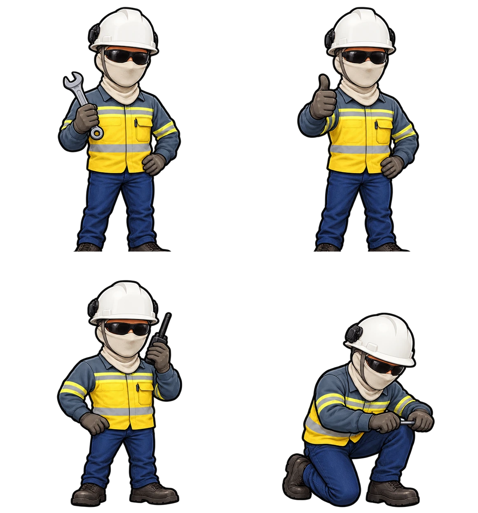
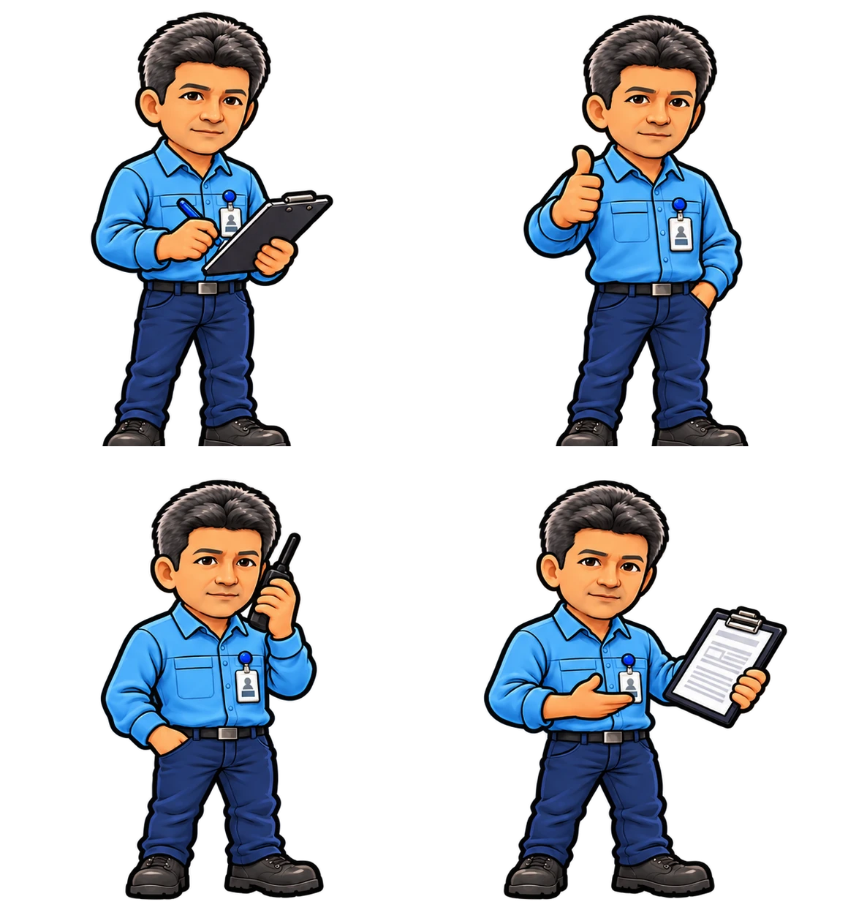

# Junior — Especialista (v0.8.18)

**Duas versões visuais do MESMO funcionário.** A arte foi fornecida pelo usuário e não foi redesenhada. Dois arquivos PNG transparentes de 1254 × 1254 px foram convertidos em dois atlas WebP alpha, 1160 × 1244 px, com quatro poses 580 × 622 px cada.

| Contexto | Arquivo | Poses |
|---|---|---|
| Trabalho na máquina/OS | `junior-work-4poses.webp` | ferramenta, positivo, rádio, reparo ajoelhado |
| Equipe e futuro menu **Gestão → Treinamentos** | `junior-training-4poses.webp` | prancheta, positivo, rádio, documentação técnica |

**Regra obrigatória:** na oficina, Junior usa **balaclava, capacete branco, óculos de proteção e uniforme amarelo**; na futura interface de treinamento usa **camisa social azul, crachá e prancheta**. As duas imagens não são personagens distintos, nem duas contratações.

**Metadados técnicos:** [manifest.json](manifest.json). Fontes originais:
- campo: `Imagem do ChatGPT 17 de out. de 2026, 22_12_33(1).png`, SHA-256 `0bb14310f3f9f1b94304c86cc7689552a78d4108d822100fc727cbdb5ba66c27`;
- treinamento: `Sprite de Trabalhador Cartoon em Quatro Poses(2).png`, SHA-256 `b5b13d49f05ef0eddf8e3bd61a61243d33243cd0c34fa1035580e7e5b58adcc1`.

As artboards foram divididas em quatro quadrantes; fragmentos separados que transbordavam para outra pose foram retirados; enquadramento, transparência e pés padronizados. WebP qualidade 91, sem alteração criativa. Dimensões de origem preservadas no manifesto.

## Motor e menus

- Equipe inicial: **Costa, Pedro, Geovane, Silva, Santos, Moura e Junior**. Junior tem a identificação **Especialista**, mas `role:'geral'` no motor até implementação e balanceamento de suas competências específicas. Não adicionar vantagem invisível ou expertise OEM não documentada.
- `sprite:'junior'`: o Phaser carrega SOMENTE `junior-work-4poses.webp` na oficina e nas ordens.
- `trainingSprite:'junior-training'`: futura interface de treinamento deverá carregar a camisa azul e pode reutilizar o retrato correspondente já exibido em **Equipe**. Não antecipar progressão/certificação sem módulo implementado.
- Migração idempotente: saves anteriores preservam todos os colaboradores e OS, incluindo um antigo contratado genérico **M7**. Junior usa o próximo ID disponível; um save com lotação máxima de 9 não recebe funcionário automaticamente até haver vaga. O limite da folha e da contratação não muda.
- Novas contratações permanecem **Mecânico**, sem sprite.
- **Teste:** `scripts/test-junior-specialist.cjs`, com integridade, contexto visual e compatibilidade de saves.

**Homologação humana pendente:** tamanho, transparência, cores/legibilidade em mobile, enquadramento das quatro poses, posição dos pés no piso e identidade correta no futuro menu pedagógico.
