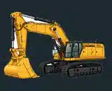
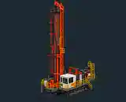
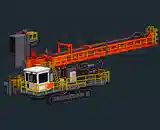
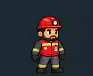

# Galeria de revisão — P.O.R.C.A.R.I.A.

Pré-visualizações **publicadas no GitHub**. São miniaturas WEBP para reconhecimento rápido, **não** os sprites PNG originais em resolução integral. Os PNGs completos estão no pacote ZIP entregue na conversa.

| CAT 395 | Sandvik DR410i — operação | Sandvik DR410i — transporte | Pedro |
|---|---|---|---|
|  |  |  |  |

## Lista completa de 115 itens

> O catálogo abaixo é exaustivo para a seleção v0.8, mas só as miniaturas acima estão efetivamente publicadas como imagem nesta branch. Os PNGs originais permanecem pendentes de transferência para o GitHub.

### equipamentos (13)

| Asset | Estado de revisão | Enviar avaliação |
|---|---|---|
| CAT 395 — escavadeira | aprovado-visual | [Avaliar](https://github.com/pedromaintenance/porcaria-voce-quebra-eu-conserto/issues/new?title=%5BASSET%5D%20CAT%20395%20%E2%80%94%20escavadeira&body=ID%3A%20equipamentos_cat395_png%0ACategoria%3A%20equipamentos%0AStatus%3A%20aprovado-visual%0AResultado%3A%20Aprovar%20%2F%20Corrigir%20%2F%20Rejeitar%0AObserva%C3%A7%C3%B5es%3A%20) |
| CAT 6030 — Backhoe (estudo) | revisao-tecnica | [Avaliar](https://github.com/pedromaintenance/porcaria-voce-quebra-eu-conserto/issues/new?title=%5BASSET%5D%20CAT%206030%20%E2%80%94%20Backhoe%20(estudo)&body=ID%3A%20equipamentos_cat6030_backhoe_estudo_png%0ACategoria%3A%20equipamentos%0AStatus%3A%20revisao-tecnica%0AResultado%3A%20Aprovar%20%2F%20Corrigir%20%2F%20Rejeitar%0AObserva%C3%A7%C3%B5es%3A%20) |
| CAT 6030 — Front Shovel (estudo) | revisao-tecnica | [Avaliar](https://github.com/pedromaintenance/porcaria-voce-quebra-eu-conserto/issues/new?title=%5BASSET%5D%20CAT%206030%20%E2%80%94%20Front%20Shovel%20(estudo)&body=ID%3A%20equipamentos_cat6030_frontshovel_estudo_png%0ACategoria%3A%20equipamentos%0AStatus%3A%20revisao-tecnica%0AResultado%3A%20Aprovar%20%2F%20Corrigir%20%2F%20Rejeitar%0AObserva%C3%A7%C3%B5es%3A%20) |
| Sandvik DR410i — mastro erguido | aprovado-visual | [Avaliar](https://github.com/pedromaintenance/porcaria-voce-quebra-eu-conserto/issues/new?title=%5BASSET%5D%20Sandvik%20DR410i%20%E2%80%94%20mastro%20erguido&body=ID%3A%20equipamentos_sandvik_dr410i_torre_erguida_png%0ACategoria%3A%20equipamentos%0AStatus%3A%20aprovado-visual%0AResultado%3A%20Aprovar%20%2F%20Corrigir%20%2F%20Rejeitar%0AObserva%C3%A7%C3%B5es%3A%20) |
| Sandvik DR410i — mastro abaixado | aprovado-visual | [Avaliar](https://github.com/pedromaintenance/porcaria-voce-quebra-eu-conserto/issues/new?title=%5BASSET%5D%20Sandvik%20DR410i%20%E2%80%94%20mastro%20abaixado&body=ID%3A%20equipamentos_sandvik_dr410i_torre_abaixada_png%0ACategoria%3A%20equipamentos%0AStatus%3A%20aprovado-visual%0AResultado%3A%20Aprovar%20%2F%20Corrigir%20%2F%20Rejeitar%0AObserva%C3%A7%C3%B5es%3A%20) |
| Perfuratriz A (estudo) | provisorio | [Avaliar](https://github.com/pedromaintenance/porcaria-voce-quebra-eu-conserto/issues/new?title=%5BASSET%5D%20Perfuratriz%20A%20(estudo)&body=ID%3A%20equipamentos_perfuratriz_a_estudo_png%0ACategoria%3A%20equipamentos%0AStatus%3A%20provisorio%0AResultado%3A%20Aprovar%20%2F%20Corrigir%20%2F%20Rejeitar%0AObserva%C3%A7%C3%B5es%3A%20) |
| Caminhão de mineração (estudo) | provisorio | [Avaliar](https://github.com/pedromaintenance/porcaria-voce-quebra-eu-conserto/issues/new?title=%5BASSET%5D%20Caminh%C3%A3o%20de%20minera%C3%A7%C3%A3o%20(estudo)&body=ID%3A%20equipamentos_caminhao_mineracao_estudo_png%0ACategoria%3A%20equipamentos%0AStatus%3A%20provisorio%0AResultado%3A%20Aprovar%20%2F%20Corrigir%20%2F%20Rejeitar%0AObserva%C3%A7%C3%B5es%3A%20) |
| CAT 6030 — conceito anterior | arquivo-historico | [Avaliar](https://github.com/pedromaintenance/porcaria-voce-quebra-eu-conserto/issues/new?title=%5BASSET%5D%20CAT%206030%20%E2%80%94%20conceito%20anterior&body=ID%3A%20equipamentos_historico_cat6030_conceito_original_png%0ACategoria%3A%20equipamentos%0AStatus%3A%20arquivo-historico%0AResultado%3A%20Aprovar%20%2F%20Corrigir%20%2F%20Rejeitar%0AObserva%C3%A7%C3%B5es%3A%20) |
| Caminhão de mina — conceito inicial | arquivo-historico | [Avaliar](https://github.com/pedromaintenance/porcaria-voce-quebra-eu-conserto/issues/new?title=%5BASSET%5D%20Caminh%C3%A3o%20de%20mina%20%E2%80%94%20conceito%20inicial&body=ID%3A%20equipamentos_historico_caminhao_pixel_art_original_png%0ACategoria%3A%20equipamentos%0AStatus%3A%20arquivo-historico%0AResultado%3A%20Aprovar%20%2F%20Corrigir%20%2F%20Rejeitar%0AObserva%C3%A7%C3%B5es%3A%20) |
| Escavadeira amarela isométrica — conceito | arquivo-historico | [Avaliar](https://github.com/pedromaintenance/porcaria-voce-quebra-eu-conserto/issues/new?title=%5BASSET%5D%20Escavadeira%20amarela%20isom%C3%A9trica%20%E2%80%94%20conceito&body=ID%3A%20equipamentos_historico_escavadeira_isometrica_original_png%0ACategoria%3A%20equipamentos%0AStatus%3A%20arquivo-historico%0AResultado%3A%20Aprovar%20%2F%20Corrigir%20%2F%20Rejeitar%0AObserva%C3%A7%C3%B5es%3A%20) |
| Escavadeira — conceito inicial | arquivo-historico | [Avaliar](https://github.com/pedromaintenance/porcaria-voce-quebra-eu-conserto/issues/new?title=%5BASSET%5D%20Escavadeira%20%E2%80%94%20conceito%20inicial&body=ID%3A%20equipamentos_historico_escavadeira_conceito_inicial_png%0ACategoria%3A%20equipamentos%0AStatus%3A%20arquivo-historico%0AResultado%3A%20Aprovar%20%2F%20Corrigir%20%2F%20Rejeitar%0AObserva%C3%A7%C3%B5es%3A%20) |
| Perfuratriz crawler — conceito | arquivo-historico | [Avaliar](https://github.com/pedromaintenance/porcaria-voce-quebra-eu-conserto/issues/new?title=%5BASSET%5D%20Perfuratriz%20crawler%20%E2%80%94%20conceito&body=ID%3A%20equipamentos_historico_perfuratriz_crawler_original_png%0ACategoria%3A%20equipamentos%0AStatus%3A%20arquivo-historico%0AResultado%3A%20Aprovar%20%2F%20Corrigir%20%2F%20Rejeitar%0AObserva%C3%A7%C3%B5es%3A%20) |
| Perfuratriz — conceito inicial | arquivo-historico | [Avaliar](https://github.com/pedromaintenance/porcaria-voce-quebra-eu-conserto/issues/new?title=%5BASSET%5D%20Perfuratriz%20%E2%80%94%20conceito%20inicial&body=ID%3A%20equipamentos_historico_perfuratriz_conceito_inicial_png%0ACategoria%3A%20equipamentos%0AStatus%3A%20arquivo-historico%0AResultado%3A%20Aprovar%20%2F%20Corrigir%20%2F%20Rejeitar%0AObserva%C3%A7%C3%B5es%3A%20) |

### pedro (8)

| Asset | Estado de revisão | Enviar avaliação |
|---|---|---|
| Pedro — alerta | aprovado-visual | [Avaliar](https://github.com/pedromaintenance/porcaria-voce-quebra-eu-conserto/issues/new?title=%5BASSET%5D%20Pedro%20%E2%80%94%20alerta&body=ID%3A%20personagens_pedro_pedro_alerta_png%0ACategoria%3A%20pedro%0AStatus%3A%20aprovado-visual%0AResultado%3A%20Aprovar%20%2F%20Corrigir%20%2F%20Rejeitar%0AObserva%C3%A7%C3%B5es%3A%20) |
| Pedro — apontando | aprovado-visual | [Avaliar](https://github.com/pedromaintenance/porcaria-voce-quebra-eu-conserto/issues/new?title=%5BASSET%5D%20Pedro%20%E2%80%94%20apontando&body=ID%3A%20personagens_pedro_pedro_apontando_png%0ACategoria%3A%20pedro%0AStatus%3A%20aprovado-visual%0AResultado%3A%20Aprovar%20%2F%20Corrigir%20%2F%20Rejeitar%0AObserva%C3%A7%C3%B5es%3A%20) |
| Pedro — extintor | aprovado-visual | [Avaliar](https://github.com/pedromaintenance/porcaria-voce-quebra-eu-conserto/issues/new?title=%5BASSET%5D%20Pedro%20%E2%80%94%20extintor&body=ID%3A%20personagens_pedro_pedro_extintor_png%0ACategoria%3A%20pedro%0AStatus%3A%20aprovado-visual%0AResultado%3A%20Aprovar%20%2F%20Corrigir%20%2F%20Rejeitar%0AObserva%C3%A7%C3%B5es%3A%20) |
| Pedro — inspecionando | aprovado-visual | [Avaliar](https://github.com/pedromaintenance/porcaria-voce-quebra-eu-conserto/issues/new?title=%5BASSET%5D%20Pedro%20%E2%80%94%20inspecionando&body=ID%3A%20personagens_pedro_pedro_inspecionando_png%0ACategoria%3A%20pedro%0AStatus%3A%20aprovado-visual%0AResultado%3A%20Aprovar%20%2F%20Corrigir%20%2F%20Rejeitar%0AObserva%C3%A7%C3%B5es%3A%20) |
| Pedro — neutro | aprovado-visual | [Avaliar](https://github.com/pedromaintenance/porcaria-voce-quebra-eu-conserto/issues/new?title=%5BASSET%5D%20Pedro%20%E2%80%94%20neutro&body=ID%3A%20personagens_pedro_pedro_neutro_png%0ACategoria%3A%20pedro%0AStatus%3A%20aprovado-visual%0AResultado%3A%20Aprovar%20%2F%20Corrigir%20%2F%20Rejeitar%0AObserva%C3%A7%C3%B5es%3A%20) |
| Pedro — positivo | aprovado-visual | [Avaliar](https://github.com/pedromaintenance/porcaria-voce-quebra-eu-conserto/issues/new?title=%5BASSET%5D%20Pedro%20%E2%80%94%20positivo&body=ID%3A%20personagens_pedro_pedro_positivo_png%0ACategoria%3A%20pedro%0AStatus%3A%20aprovado-visual%0AResultado%3A%20Aprovar%20%2F%20Corrigir%20%2F%20Rejeitar%0AObserva%C3%A7%C3%B5es%3A%20) |
| Pedro — prancheta | aprovado-visual | [Avaliar](https://github.com/pedromaintenance/porcaria-voce-quebra-eu-conserto/issues/new?title=%5BASSET%5D%20Pedro%20%E2%80%94%20prancheta&body=ID%3A%20personagens_pedro_pedro_prancheta_png%0ACategoria%3A%20pedro%0AStatus%3A%20aprovado-visual%0AResultado%3A%20Aprovar%20%2F%20Corrigir%20%2F%20Rejeitar%0AObserva%C3%A7%C3%B5es%3A%20) |
| Pedro — radio | aprovado-visual | [Avaliar](https://github.com/pedromaintenance/porcaria-voce-quebra-eu-conserto/issues/new?title=%5BASSET%5D%20Pedro%20%E2%80%94%20radio&body=ID%3A%20personagens_pedro_pedro_radio_png%0ACategoria%3A%20pedro%0AStatus%3A%20aprovado-visual%0AResultado%3A%20Aprovar%20%2F%20Corrigir%20%2F%20Rejeitar%0AObserva%C3%A7%C3%B5es%3A%20) |

### elenco (72)

| Asset | Estado de revisão | Enviar avaliação |
|---|---|---|
| Ana — alert | revisao-visual | [Avaliar](https://github.com/pedromaintenance/porcaria-voce-quebra-eu-conserto/issues/new?title=%5BASSET%5D%20Ana%20%E2%80%94%20alert&body=ID%3A%20personagens_elenco_mec_ana_alert_png%0ACategoria%3A%20elenco%0AStatus%3A%20revisao-visual%0AResultado%3A%20Aprovar%20%2F%20Corrigir%20%2F%20Rejeitar%0AObserva%C3%A7%C3%B5es%3A%20) |
| Ana — clipboard | revisao-visual | [Avaliar](https://github.com/pedromaintenance/porcaria-voce-quebra-eu-conserto/issues/new?title=%5BASSET%5D%20Ana%20%E2%80%94%20clipboard&body=ID%3A%20personagens_elenco_mec_ana_clipboard_png%0ACategoria%3A%20elenco%0AStatus%3A%20revisao-visual%0AResultado%3A%20Aprovar%20%2F%20Corrigir%20%2F%20Rejeitar%0AObserva%C3%A7%C3%B5es%3A%20) |
| Ana — extinguisher | revisao-visual | [Avaliar](https://github.com/pedromaintenance/porcaria-voce-quebra-eu-conserto/issues/new?title=%5BASSET%5D%20Ana%20%E2%80%94%20extinguisher&body=ID%3A%20personagens_elenco_mec_ana_extinguisher_png%0ACategoria%3A%20elenco%0AStatus%3A%20revisao-visual%0AResultado%3A%20Aprovar%20%2F%20Corrigir%20%2F%20Rejeitar%0AObserva%C3%A7%C3%B5es%3A%20) |
| Ana — idle | revisao-visual | [Avaliar](https://github.com/pedromaintenance/porcaria-voce-quebra-eu-conserto/issues/new?title=%5BASSET%5D%20Ana%20%E2%80%94%20idle&body=ID%3A%20personagens_elenco_mec_ana_idle_png%0ACategoria%3A%20elenco%0AStatus%3A%20revisao-visual%0AResultado%3A%20Aprovar%20%2F%20Corrigir%20%2F%20Rejeitar%0AObserva%C3%A7%C3%B5es%3A%20) |
| Ana — inspect | revisao-visual | [Avaliar](https://github.com/pedromaintenance/porcaria-voce-quebra-eu-conserto/issues/new?title=%5BASSET%5D%20Ana%20%E2%80%94%20inspect&body=ID%3A%20personagens_elenco_mec_ana_inspect_png%0ACategoria%3A%20elenco%0AStatus%3A%20revisao-visual%0AResultado%3A%20Aprovar%20%2F%20Corrigir%20%2F%20Rejeitar%0AObserva%C3%A7%C3%B5es%3A%20) |
| Ana — point | revisao-visual | [Avaliar](https://github.com/pedromaintenance/porcaria-voce-quebra-eu-conserto/issues/new?title=%5BASSET%5D%20Ana%20%E2%80%94%20point&body=ID%3A%20personagens_elenco_mec_ana_point_png%0ACategoria%3A%20elenco%0AStatus%3A%20revisao-visual%0AResultado%3A%20Aprovar%20%2F%20Corrigir%20%2F%20Rejeitar%0AObserva%C3%A7%C3%B5es%3A%20) |
| Ana — positive | revisao-visual | [Avaliar](https://github.com/pedromaintenance/porcaria-voce-quebra-eu-conserto/issues/new?title=%5BASSET%5D%20Ana%20%E2%80%94%20positive&body=ID%3A%20personagens_elenco_mec_ana_positive_png%0ACategoria%3A%20elenco%0AStatus%3A%20revisao-visual%0AResultado%3A%20Aprovar%20%2F%20Corrigir%20%2F%20Rejeitar%0AObserva%C3%A7%C3%B5es%3A%20) |
| Ana — radio | revisao-visual | [Avaliar](https://github.com/pedromaintenance/porcaria-voce-quebra-eu-conserto/issues/new?title=%5BASSET%5D%20Ana%20%E2%80%94%20radio&body=ID%3A%20personagens_elenco_mec_ana_radio_png%0ACategoria%3A%20elenco%0AStatus%3A%20revisao-visual%0AResultado%3A%20Aprovar%20%2F%20Corrigir%20%2F%20Rejeitar%0AObserva%C3%A7%C3%B5es%3A%20) |
| Ana — spritesheet | revisao-visual | [Avaliar](https://github.com/pedromaintenance/porcaria-voce-quebra-eu-conserto/issues/new?title=%5BASSET%5D%20Ana%20%E2%80%94%20spritesheet&body=ID%3A%20personagens_elenco_mec_ana_spritesheet_png%0ACategoria%3A%20elenco%0AStatus%3A%20revisao-visual%0AResultado%3A%20Aprovar%20%2F%20Corrigir%20%2F%20Rejeitar%0AObserva%C3%A7%C3%B5es%3A%20) |
| Rafael — alert | preview-validado | [Avaliar](https://github.com/pedromaintenance/porcaria-voce-quebra-eu-conserto/issues/new?title=%5BASSET%5D%20Rafael%20%E2%80%94%20alert&body=ID%3A%20personagens_elenco_mec_rafael_alert_png%0ACategoria%3A%20elenco%0AStatus%3A%20preview-validado%0AResultado%3A%20Aprovar%20%2F%20Corrigir%20%2F%20Rejeitar%0AObserva%C3%A7%C3%B5es%3A%20) |
| Rafael — clipboard | preview-validado | [Avaliar](https://github.com/pedromaintenance/porcaria-voce-quebra-eu-conserto/issues/new?title=%5BASSET%5D%20Rafael%20%E2%80%94%20clipboard&body=ID%3A%20personagens_elenco_mec_rafael_clipboard_png%0ACategoria%3A%20elenco%0AStatus%3A%20preview-validado%0AResultado%3A%20Aprovar%20%2F%20Corrigir%20%2F%20Rejeitar%0AObserva%C3%A7%C3%B5es%3A%20) |
| Rafael — extinguisher | preview-validado | [Avaliar](https://github.com/pedromaintenance/porcaria-voce-quebra-eu-conserto/issues/new?title=%5BASSET%5D%20Rafael%20%E2%80%94%20extinguisher&body=ID%3A%20personagens_elenco_mec_rafael_extinguisher_png%0ACategoria%3A%20elenco%0AStatus%3A%20preview-validado%0AResultado%3A%20Aprovar%20%2F%20Corrigir%20%2F%20Rejeitar%0AObserva%C3%A7%C3%B5es%3A%20) |
| Rafael — idle | preview-validado | [Avaliar](https://github.com/pedromaintenance/porcaria-voce-quebra-eu-conserto/issues/new?title=%5BASSET%5D%20Rafael%20%E2%80%94%20idle&body=ID%3A%20personagens_elenco_mec_rafael_idle_png%0ACategoria%3A%20elenco%0AStatus%3A%20preview-validado%0AResultado%3A%20Aprovar%20%2F%20Corrigir%20%2F%20Rejeitar%0AObserva%C3%A7%C3%B5es%3A%20) |
| Rafael — inspect | preview-validado | [Avaliar](https://github.com/pedromaintenance/porcaria-voce-quebra-eu-conserto/issues/new?title=%5BASSET%5D%20Rafael%20%E2%80%94%20inspect&body=ID%3A%20personagens_elenco_mec_rafael_inspect_png%0ACategoria%3A%20elenco%0AStatus%3A%20preview-validado%0AResultado%3A%20Aprovar%20%2F%20Corrigir%20%2F%20Rejeitar%0AObserva%C3%A7%C3%B5es%3A%20) |
| Rafael — point | preview-validado | [Avaliar](https://github.com/pedromaintenance/porcaria-voce-quebra-eu-conserto/issues/new?title=%5BASSET%5D%20Rafael%20%E2%80%94%20point&body=ID%3A%20personagens_elenco_mec_rafael_point_png%0ACategoria%3A%20elenco%0AStatus%3A%20preview-validado%0AResultado%3A%20Aprovar%20%2F%20Corrigir%20%2F%20Rejeitar%0AObserva%C3%A7%C3%B5es%3A%20) |
| Rafael — positive | preview-validado | [Avaliar](https://github.com/pedromaintenance/porcaria-voce-quebra-eu-conserto/issues/new?title=%5BASSET%5D%20Rafael%20%E2%80%94%20positive&body=ID%3A%20personagens_elenco_mec_rafael_positive_png%0ACategoria%3A%20elenco%0AStatus%3A%20preview-validado%0AResultado%3A%20Aprovar%20%2F%20Corrigir%20%2F%20Rejeitar%0AObserva%C3%A7%C3%B5es%3A%20) |
| Rafael — radio | preview-validado | [Avaliar](https://github.com/pedromaintenance/porcaria-voce-quebra-eu-conserto/issues/new?title=%5BASSET%5D%20Rafael%20%E2%80%94%20radio&body=ID%3A%20personagens_elenco_mec_rafael_radio_png%0ACategoria%3A%20elenco%0AStatus%3A%20preview-validado%0AResultado%3A%20Aprovar%20%2F%20Corrigir%20%2F%20Rejeitar%0AObserva%C3%A7%C3%B5es%3A%20) |
| Rafael — spritesheet | preview-validado | [Avaliar](https://github.com/pedromaintenance/porcaria-voce-quebra-eu-conserto/issues/new?title=%5BASSET%5D%20Rafael%20%E2%80%94%20spritesheet&body=ID%3A%20personagens_elenco_mec_rafael_spritesheet_png%0ACategoria%3A%20elenco%0AStatus%3A%20preview-validado%0AResultado%3A%20Aprovar%20%2F%20Corrigir%20%2F%20Rejeitar%0AObserva%C3%A7%C3%B5es%3A%20) |
| Lia — alert | revisao-visual | [Avaliar](https://github.com/pedromaintenance/porcaria-voce-quebra-eu-conserto/issues/new?title=%5BASSET%5D%20Lia%20%E2%80%94%20alert&body=ID%3A%20personagens_elenco_mec_lia_alert_png%0ACategoria%3A%20elenco%0AStatus%3A%20revisao-visual%0AResultado%3A%20Aprovar%20%2F%20Corrigir%20%2F%20Rejeitar%0AObserva%C3%A7%C3%B5es%3A%20) |
| Lia — clipboard | revisao-visual | [Avaliar](https://github.com/pedromaintenance/porcaria-voce-quebra-eu-conserto/issues/new?title=%5BASSET%5D%20Lia%20%E2%80%94%20clipboard&body=ID%3A%20personagens_elenco_mec_lia_clipboard_png%0ACategoria%3A%20elenco%0AStatus%3A%20revisao-visual%0AResultado%3A%20Aprovar%20%2F%20Corrigir%20%2F%20Rejeitar%0AObserva%C3%A7%C3%B5es%3A%20) |
| Lia — extinguisher | revisao-visual | [Avaliar](https://github.com/pedromaintenance/porcaria-voce-quebra-eu-conserto/issues/new?title=%5BASSET%5D%20Lia%20%E2%80%94%20extinguisher&body=ID%3A%20personagens_elenco_mec_lia_extinguisher_png%0ACategoria%3A%20elenco%0AStatus%3A%20revisao-visual%0AResultado%3A%20Aprovar%20%2F%20Corrigir%20%2F%20Rejeitar%0AObserva%C3%A7%C3%B5es%3A%20) |
| Lia — idle | revisao-visual | [Avaliar](https://github.com/pedromaintenance/porcaria-voce-quebra-eu-conserto/issues/new?title=%5BASSET%5D%20Lia%20%E2%80%94%20idle&body=ID%3A%20personagens_elenco_mec_lia_idle_png%0ACategoria%3A%20elenco%0AStatus%3A%20revisao-visual%0AResultado%3A%20Aprovar%20%2F%20Corrigir%20%2F%20Rejeitar%0AObserva%C3%A7%C3%B5es%3A%20) |
| Lia — inspect | revisao-visual | [Avaliar](https://github.com/pedromaintenance/porcaria-voce-quebra-eu-conserto/issues/new?title=%5BASSET%5D%20Lia%20%E2%80%94%20inspect&body=ID%3A%20personagens_elenco_mec_lia_inspect_png%0ACategoria%3A%20elenco%0AStatus%3A%20revisao-visual%0AResultado%3A%20Aprovar%20%2F%20Corrigir%20%2F%20Rejeitar%0AObserva%C3%A7%C3%B5es%3A%20) |
| Lia — point | revisao-visual | [Avaliar](https://github.com/pedromaintenance/porcaria-voce-quebra-eu-conserto/issues/new?title=%5BASSET%5D%20Lia%20%E2%80%94%20point&body=ID%3A%20personagens_elenco_mec_lia_point_png%0ACategoria%3A%20elenco%0AStatus%3A%20revisao-visual%0AResultado%3A%20Aprovar%20%2F%20Corrigir%20%2F%20Rejeitar%0AObserva%C3%A7%C3%B5es%3A%20) |
| Lia — positive | revisao-visual | [Avaliar](https://github.com/pedromaintenance/porcaria-voce-quebra-eu-conserto/issues/new?title=%5BASSET%5D%20Lia%20%E2%80%94%20positive&body=ID%3A%20personagens_elenco_mec_lia_positive_png%0ACategoria%3A%20elenco%0AStatus%3A%20revisao-visual%0AResultado%3A%20Aprovar%20%2F%20Corrigir%20%2F%20Rejeitar%0AObserva%C3%A7%C3%B5es%3A%20) |
| Lia — radio | revisao-visual | [Avaliar](https://github.com/pedromaintenance/porcaria-voce-quebra-eu-conserto/issues/new?title=%5BASSET%5D%20Lia%20%E2%80%94%20radio&body=ID%3A%20personagens_elenco_mec_lia_radio_png%0ACategoria%3A%20elenco%0AStatus%3A%20revisao-visual%0AResultado%3A%20Aprovar%20%2F%20Corrigir%20%2F%20Rejeitar%0AObserva%C3%A7%C3%B5es%3A%20) |
| Lia — spritesheet | revisao-visual | [Avaliar](https://github.com/pedromaintenance/porcaria-voce-quebra-eu-conserto/issues/new?title=%5BASSET%5D%20Lia%20%E2%80%94%20spritesheet&body=ID%3A%20personagens_elenco_mec_lia_spritesheet_png%0ACategoria%3A%20elenco%0AStatus%3A%20revisao-visual%0AResultado%3A%20Aprovar%20%2F%20Corrigir%20%2F%20Rejeitar%0AObserva%C3%A7%C3%B5es%3A%20) |
| Davi — alert | preview-validado | [Avaliar](https://github.com/pedromaintenance/porcaria-voce-quebra-eu-conserto/issues/new?title=%5BASSET%5D%20Davi%20%E2%80%94%20alert&body=ID%3A%20personagens_elenco_ele_davi_alert_png%0ACategoria%3A%20elenco%0AStatus%3A%20preview-validado%0AResultado%3A%20Aprovar%20%2F%20Corrigir%20%2F%20Rejeitar%0AObserva%C3%A7%C3%B5es%3A%20) |
| Davi — clipboard | preview-validado | [Avaliar](https://github.com/pedromaintenance/porcaria-voce-quebra-eu-conserto/issues/new?title=%5BASSET%5D%20Davi%20%E2%80%94%20clipboard&body=ID%3A%20personagens_elenco_ele_davi_clipboard_png%0ACategoria%3A%20elenco%0AStatus%3A%20preview-validado%0AResultado%3A%20Aprovar%20%2F%20Corrigir%20%2F%20Rejeitar%0AObserva%C3%A7%C3%B5es%3A%20) |
| Davi — extinguisher | preview-validado | [Avaliar](https://github.com/pedromaintenance/porcaria-voce-quebra-eu-conserto/issues/new?title=%5BASSET%5D%20Davi%20%E2%80%94%20extinguisher&body=ID%3A%20personagens_elenco_ele_davi_extinguisher_png%0ACategoria%3A%20elenco%0AStatus%3A%20preview-validado%0AResultado%3A%20Aprovar%20%2F%20Corrigir%20%2F%20Rejeitar%0AObserva%C3%A7%C3%B5es%3A%20) |
| Davi — idle | preview-validado | [Avaliar](https://github.com/pedromaintenance/porcaria-voce-quebra-eu-conserto/issues/new?title=%5BASSET%5D%20Davi%20%E2%80%94%20idle&body=ID%3A%20personagens_elenco_ele_davi_idle_png%0ACategoria%3A%20elenco%0AStatus%3A%20preview-validado%0AResultado%3A%20Aprovar%20%2F%20Corrigir%20%2F%20Rejeitar%0AObserva%C3%A7%C3%B5es%3A%20) |
| Davi — inspect | preview-validado | [Avaliar](https://github.com/pedromaintenance/porcaria-voce-quebra-eu-conserto/issues/new?title=%5BASSET%5D%20Davi%20%E2%80%94%20inspect&body=ID%3A%20personagens_elenco_ele_davi_inspect_png%0ACategoria%3A%20elenco%0AStatus%3A%20preview-validado%0AResultado%3A%20Aprovar%20%2F%20Corrigir%20%2F%20Rejeitar%0AObserva%C3%A7%C3%B5es%3A%20) |
| Davi — point | preview-validado | [Avaliar](https://github.com/pedromaintenance/porcaria-voce-quebra-eu-conserto/issues/new?title=%5BASSET%5D%20Davi%20%E2%80%94%20point&body=ID%3A%20personagens_elenco_ele_davi_point_png%0ACategoria%3A%20elenco%0AStatus%3A%20preview-validado%0AResultado%3A%20Aprovar%20%2F%20Corrigir%20%2F%20Rejeitar%0AObserva%C3%A7%C3%B5es%3A%20) |
| Davi — positive | preview-validado | [Avaliar](https://github.com/pedromaintenance/porcaria-voce-quebra-eu-conserto/issues/new?title=%5BASSET%5D%20Davi%20%E2%80%94%20positive&body=ID%3A%20personagens_elenco_ele_davi_positive_png%0ACategoria%3A%20elenco%0AStatus%3A%20preview-validado%0AResultado%3A%20Aprovar%20%2F%20Corrigir%20%2F%20Rejeitar%0AObserva%C3%A7%C3%B5es%3A%20) |
| Davi — radio | preview-validado | [Avaliar](https://github.com/pedromaintenance/porcaria-voce-quebra-eu-conserto/issues/new?title=%5BASSET%5D%20Davi%20%E2%80%94%20radio&body=ID%3A%20personagens_elenco_ele_davi_radio_png%0ACategoria%3A%20elenco%0AStatus%3A%20preview-validado%0AResultado%3A%20Aprovar%20%2F%20Corrigir%20%2F%20Rejeitar%0AObserva%C3%A7%C3%B5es%3A%20) |
| Davi — spritesheet | preview-validado | [Avaliar](https://github.com/pedromaintenance/porcaria-voce-quebra-eu-conserto/issues/new?title=%5BASSET%5D%20Davi%20%E2%80%94%20spritesheet&body=ID%3A%20personagens_elenco_ele_davi_spritesheet_png%0ACategoria%3A%20elenco%0AStatus%3A%20preview-validado%0AResultado%3A%20Aprovar%20%2F%20Corrigir%20%2F%20Rejeitar%0AObserva%C3%A7%C3%B5es%3A%20) |
| Bia — alert | revisao-visual | [Avaliar](https://github.com/pedromaintenance/porcaria-voce-quebra-eu-conserto/issues/new?title=%5BASSET%5D%20Bia%20%E2%80%94%20alert&body=ID%3A%20personagens_elenco_ele_bia_alert_png%0ACategoria%3A%20elenco%0AStatus%3A%20revisao-visual%0AResultado%3A%20Aprovar%20%2F%20Corrigir%20%2F%20Rejeitar%0AObserva%C3%A7%C3%B5es%3A%20) |
| Bia — clipboard | revisao-visual | [Avaliar](https://github.com/pedromaintenance/porcaria-voce-quebra-eu-conserto/issues/new?title=%5BASSET%5D%20Bia%20%E2%80%94%20clipboard&body=ID%3A%20personagens_elenco_ele_bia_clipboard_png%0ACategoria%3A%20elenco%0AStatus%3A%20revisao-visual%0AResultado%3A%20Aprovar%20%2F%20Corrigir%20%2F%20Rejeitar%0AObserva%C3%A7%C3%B5es%3A%20) |
| Bia — extinguisher | revisao-visual | [Avaliar](https://github.com/pedromaintenance/porcaria-voce-quebra-eu-conserto/issues/new?title=%5BASSET%5D%20Bia%20%E2%80%94%20extinguisher&body=ID%3A%20personagens_elenco_ele_bia_extinguisher_png%0ACategoria%3A%20elenco%0AStatus%3A%20revisao-visual%0AResultado%3A%20Aprovar%20%2F%20Corrigir%20%2F%20Rejeitar%0AObserva%C3%A7%C3%B5es%3A%20) |
| Bia — idle | revisao-visual | [Avaliar](https://github.com/pedromaintenance/porcaria-voce-quebra-eu-conserto/issues/new?title=%5BASSET%5D%20Bia%20%E2%80%94%20idle&body=ID%3A%20personagens_elenco_ele_bia_idle_png%0ACategoria%3A%20elenco%0AStatus%3A%20revisao-visual%0AResultado%3A%20Aprovar%20%2F%20Corrigir%20%2F%20Rejeitar%0AObserva%C3%A7%C3%B5es%3A%20) |
| Bia — inspect | revisao-visual | [Avaliar](https://github.com/pedromaintenance/porcaria-voce-quebra-eu-conserto/issues/new?title=%5BASSET%5D%20Bia%20%E2%80%94%20inspect&body=ID%3A%20personagens_elenco_ele_bia_inspect_png%0ACategoria%3A%20elenco%0AStatus%3A%20revisao-visual%0AResultado%3A%20Aprovar%20%2F%20Corrigir%20%2F%20Rejeitar%0AObserva%C3%A7%C3%B5es%3A%20) |
| Bia — point | revisao-visual | [Avaliar](https://github.com/pedromaintenance/porcaria-voce-quebra-eu-conserto/issues/new?title=%5BASSET%5D%20Bia%20%E2%80%94%20point&body=ID%3A%20personagens_elenco_ele_bia_point_png%0ACategoria%3A%20elenco%0AStatus%3A%20revisao-visual%0AResultado%3A%20Aprovar%20%2F%20Corrigir%20%2F%20Rejeitar%0AObserva%C3%A7%C3%B5es%3A%20) |
| Bia — positive | revisao-visual | [Avaliar](https://github.com/pedromaintenance/porcaria-voce-quebra-eu-conserto/issues/new?title=%5BASSET%5D%20Bia%20%E2%80%94%20positive&body=ID%3A%20personagens_elenco_ele_bia_positive_png%0ACategoria%3A%20elenco%0AStatus%3A%20revisao-visual%0AResultado%3A%20Aprovar%20%2F%20Corrigir%20%2F%20Rejeitar%0AObserva%C3%A7%C3%B5es%3A%20) |
| Bia — radio | revisao-visual | [Avaliar](https://github.com/pedromaintenance/porcaria-voce-quebra-eu-conserto/issues/new?title=%5BASSET%5D%20Bia%20%E2%80%94%20radio&body=ID%3A%20personagens_elenco_ele_bia_radio_png%0ACategoria%3A%20elenco%0AStatus%3A%20revisao-visual%0AResultado%3A%20Aprovar%20%2F%20Corrigir%20%2F%20Rejeitar%0AObserva%C3%A7%C3%B5es%3A%20) |
| Bia — spritesheet | revisao-visual | [Avaliar](https://github.com/pedromaintenance/porcaria-voce-quebra-eu-conserto/issues/new?title=%5BASSET%5D%20Bia%20%E2%80%94%20spritesheet&body=ID%3A%20personagens_elenco_ele_bia_spritesheet_png%0ACategoria%3A%20elenco%0AStatus%3A%20revisao-visual%0AResultado%3A%20Aprovar%20%2F%20Corrigir%20%2F%20Rejeitar%0AObserva%C3%A7%C3%B5es%3A%20) |
| Clara — alert | revisao-visual | [Avaliar](https://github.com/pedromaintenance/porcaria-voce-quebra-eu-conserto/issues/new?title=%5BASSET%5D%20Clara%20%E2%80%94%20alert&body=ID%3A%20personagens_elenco_pcm_clara_alert_png%0ACategoria%3A%20elenco%0AStatus%3A%20revisao-visual%0AResultado%3A%20Aprovar%20%2F%20Corrigir%20%2F%20Rejeitar%0AObserva%C3%A7%C3%B5es%3A%20) |
| Clara — clipboard | revisao-visual | [Avaliar](https://github.com/pedromaintenance/porcaria-voce-quebra-eu-conserto/issues/new?title=%5BASSET%5D%20Clara%20%E2%80%94%20clipboard&body=ID%3A%20personagens_elenco_pcm_clara_clipboard_png%0ACategoria%3A%20elenco%0AStatus%3A%20revisao-visual%0AResultado%3A%20Aprovar%20%2F%20Corrigir%20%2F%20Rejeitar%0AObserva%C3%A7%C3%B5es%3A%20) |
| Clara — extinguisher | revisao-visual | [Avaliar](https://github.com/pedromaintenance/porcaria-voce-quebra-eu-conserto/issues/new?title=%5BASSET%5D%20Clara%20%E2%80%94%20extinguisher&body=ID%3A%20personagens_elenco_pcm_clara_extinguisher_png%0ACategoria%3A%20elenco%0AStatus%3A%20revisao-visual%0AResultado%3A%20Aprovar%20%2F%20Corrigir%20%2F%20Rejeitar%0AObserva%C3%A7%C3%B5es%3A%20) |
| Clara — idle | revisao-visual | [Avaliar](https://github.com/pedromaintenance/porcaria-voce-quebra-eu-conserto/issues/new?title=%5BASSET%5D%20Clara%20%E2%80%94%20idle&body=ID%3A%20personagens_elenco_pcm_clara_idle_png%0ACategoria%3A%20elenco%0AStatus%3A%20revisao-visual%0AResultado%3A%20Aprovar%20%2F%20Corrigir%20%2F%20Rejeitar%0AObserva%C3%A7%C3%B5es%3A%20) |
| Clara — inspect | revisao-visual | [Avaliar](https://github.com/pedromaintenance/porcaria-voce-quebra-eu-conserto/issues/new?title=%5BASSET%5D%20Clara%20%E2%80%94%20inspect&body=ID%3A%20personagens_elenco_pcm_clara_inspect_png%0ACategoria%3A%20elenco%0AStatus%3A%20revisao-visual%0AResultado%3A%20Aprovar%20%2F%20Corrigir%20%2F%20Rejeitar%0AObserva%C3%A7%C3%B5es%3A%20) |
| Clara — point | revisao-visual | [Avaliar](https://github.com/pedromaintenance/porcaria-voce-quebra-eu-conserto/issues/new?title=%5BASSET%5D%20Clara%20%E2%80%94%20point&body=ID%3A%20personagens_elenco_pcm_clara_point_png%0ACategoria%3A%20elenco%0AStatus%3A%20revisao-visual%0AResultado%3A%20Aprovar%20%2F%20Corrigir%20%2F%20Rejeitar%0AObserva%C3%A7%C3%B5es%3A%20) |
| Clara — positive | revisao-visual | [Avaliar](https://github.com/pedromaintenance/porcaria-voce-quebra-eu-conserto/issues/new?title=%5BASSET%5D%20Clara%20%E2%80%94%20positive&body=ID%3A%20personagens_elenco_pcm_clara_positive_png%0ACategoria%3A%20elenco%0AStatus%3A%20revisao-visual%0AResultado%3A%20Aprovar%20%2F%20Corrigir%20%2F%20Rejeitar%0AObserva%C3%A7%C3%B5es%3A%20) |
| Clara — radio | revisao-visual | [Avaliar](https://github.com/pedromaintenance/porcaria-voce-quebra-eu-conserto/issues/new?title=%5BASSET%5D%20Clara%20%E2%80%94%20radio&body=ID%3A%20personagens_elenco_pcm_clara_radio_png%0ACategoria%3A%20elenco%0AStatus%3A%20revisao-visual%0AResultado%3A%20Aprovar%20%2F%20Corrigir%20%2F%20Rejeitar%0AObserva%C3%A7%C3%B5es%3A%20) |
| Clara — spritesheet | revisao-visual | [Avaliar](https://github.com/pedromaintenance/porcaria-voce-quebra-eu-conserto/issues/new?title=%5BASSET%5D%20Clara%20%E2%80%94%20spritesheet&body=ID%3A%20personagens_elenco_pcm_clara_spritesheet_png%0ACategoria%3A%20elenco%0AStatus%3A%20revisao-visual%0AResultado%3A%20Aprovar%20%2F%20Corrigir%20%2F%20Rejeitar%0AObserva%C3%A7%C3%B5es%3A%20) |
| João — alert | preview-validado | [Avaliar](https://github.com/pedromaintenance/porcaria-voce-quebra-eu-conserto/issues/new?title=%5BASSET%5D%20Jo%C3%A3o%20%E2%80%94%20alert&body=ID%3A%20personagens_elenco_pcm_joao_alert_png%0ACategoria%3A%20elenco%0AStatus%3A%20preview-validado%0AResultado%3A%20Aprovar%20%2F%20Corrigir%20%2F%20Rejeitar%0AObserva%C3%A7%C3%B5es%3A%20) |
| João — clipboard | preview-validado | [Avaliar](https://github.com/pedromaintenance/porcaria-voce-quebra-eu-conserto/issues/new?title=%5BASSET%5D%20Jo%C3%A3o%20%E2%80%94%20clipboard&body=ID%3A%20personagens_elenco_pcm_joao_clipboard_png%0ACategoria%3A%20elenco%0AStatus%3A%20preview-validado%0AResultado%3A%20Aprovar%20%2F%20Corrigir%20%2F%20Rejeitar%0AObserva%C3%A7%C3%B5es%3A%20) |
| João — extinguisher | preview-validado | [Avaliar](https://github.com/pedromaintenance/porcaria-voce-quebra-eu-conserto/issues/new?title=%5BASSET%5D%20Jo%C3%A3o%20%E2%80%94%20extinguisher&body=ID%3A%20personagens_elenco_pcm_joao_extinguisher_png%0ACategoria%3A%20elenco%0AStatus%3A%20preview-validado%0AResultado%3A%20Aprovar%20%2F%20Corrigir%20%2F%20Rejeitar%0AObserva%C3%A7%C3%B5es%3A%20) |
| João — idle | preview-validado | [Avaliar](https://github.com/pedromaintenance/porcaria-voce-quebra-eu-conserto/issues/new?title=%5BASSET%5D%20Jo%C3%A3o%20%E2%80%94%20idle&body=ID%3A%20personagens_elenco_pcm_joao_idle_png%0ACategoria%3A%20elenco%0AStatus%3A%20preview-validado%0AResultado%3A%20Aprovar%20%2F%20Corrigir%20%2F%20Rejeitar%0AObserva%C3%A7%C3%B5es%3A%20) |
| João — inspect | preview-validado | [Avaliar](https://github.com/pedromaintenance/porcaria-voce-quebra-eu-conserto/issues/new?title=%5BASSET%5D%20Jo%C3%A3o%20%E2%80%94%20inspect&body=ID%3A%20personagens_elenco_pcm_joao_inspect_png%0ACategoria%3A%20elenco%0AStatus%3A%20preview-validado%0AResultado%3A%20Aprovar%20%2F%20Corrigir%20%2F%20Rejeitar%0AObserva%C3%A7%C3%B5es%3A%20) |
| João — point | preview-validado | [Avaliar](https://github.com/pedromaintenance/porcaria-voce-quebra-eu-conserto/issues/new?title=%5BASSET%5D%20Jo%C3%A3o%20%E2%80%94%20point&body=ID%3A%20personagens_elenco_pcm_joao_point_png%0ACategoria%3A%20elenco%0AStatus%3A%20preview-validado%0AResultado%3A%20Aprovar%20%2F%20Corrigir%20%2F%20Rejeitar%0AObserva%C3%A7%C3%B5es%3A%20) |
| João — positive | preview-validado | [Avaliar](https://github.com/pedromaintenance/porcaria-voce-quebra-eu-conserto/issues/new?title=%5BASSET%5D%20Jo%C3%A3o%20%E2%80%94%20positive&body=ID%3A%20personagens_elenco_pcm_joao_positive_png%0ACategoria%3A%20elenco%0AStatus%3A%20preview-validado%0AResultado%3A%20Aprovar%20%2F%20Corrigir%20%2F%20Rejeitar%0AObserva%C3%A7%C3%B5es%3A%20) |
| João — radio | preview-validado | [Avaliar](https://github.com/pedromaintenance/porcaria-voce-quebra-eu-conserto/issues/new?title=%5BASSET%5D%20Jo%C3%A3o%20%E2%80%94%20radio&body=ID%3A%20personagens_elenco_pcm_joao_radio_png%0ACategoria%3A%20elenco%0AStatus%3A%20preview-validado%0AResultado%3A%20Aprovar%20%2F%20Corrigir%20%2F%20Rejeitar%0AObserva%C3%A7%C3%B5es%3A%20) |
| João — spritesheet | preview-validado | [Avaliar](https://github.com/pedromaintenance/porcaria-voce-quebra-eu-conserto/issues/new?title=%5BASSET%5D%20Jo%C3%A3o%20%E2%80%94%20spritesheet&body=ID%3A%20personagens_elenco_pcm_joao_spritesheet_png%0ACategoria%3A%20elenco%0AStatus%3A%20preview-validado%0AResultado%3A%20Aprovar%20%2F%20Corrigir%20%2F%20Rejeitar%0AObserva%C3%A7%C3%B5es%3A%20) |
| Nina — alert | revisao-visual | [Avaliar](https://github.com/pedromaintenance/porcaria-voce-quebra-eu-conserto/issues/new?title=%5BASSET%5D%20Nina%20%E2%80%94%20alert&body=ID%3A%20personagens_elenco_brig_nina_alert_png%0ACategoria%3A%20elenco%0AStatus%3A%20revisao-visual%0AResultado%3A%20Aprovar%20%2F%20Corrigir%20%2F%20Rejeitar%0AObserva%C3%A7%C3%B5es%3A%20) |
| Nina — clipboard | revisao-visual | [Avaliar](https://github.com/pedromaintenance/porcaria-voce-quebra-eu-conserto/issues/new?title=%5BASSET%5D%20Nina%20%E2%80%94%20clipboard&body=ID%3A%20personagens_elenco_brig_nina_clipboard_png%0ACategoria%3A%20elenco%0AStatus%3A%20revisao-visual%0AResultado%3A%20Aprovar%20%2F%20Corrigir%20%2F%20Rejeitar%0AObserva%C3%A7%C3%B5es%3A%20) |
| Nina — extinguisher | revisao-visual | [Avaliar](https://github.com/pedromaintenance/porcaria-voce-quebra-eu-conserto/issues/new?title=%5BASSET%5D%20Nina%20%E2%80%94%20extinguisher&body=ID%3A%20personagens_elenco_brig_nina_extinguisher_png%0ACategoria%3A%20elenco%0AStatus%3A%20revisao-visual%0AResultado%3A%20Aprovar%20%2F%20Corrigir%20%2F%20Rejeitar%0AObserva%C3%A7%C3%B5es%3A%20) |
| Nina — idle | revisao-visual | [Avaliar](https://github.com/pedromaintenance/porcaria-voce-quebra-eu-conserto/issues/new?title=%5BASSET%5D%20Nina%20%E2%80%94%20idle&body=ID%3A%20personagens_elenco_brig_nina_idle_png%0ACategoria%3A%20elenco%0AStatus%3A%20revisao-visual%0AResultado%3A%20Aprovar%20%2F%20Corrigir%20%2F%20Rejeitar%0AObserva%C3%A7%C3%B5es%3A%20) |
| Nina — inspect | revisao-visual | [Avaliar](https://github.com/pedromaintenance/porcaria-voce-quebra-eu-conserto/issues/new?title=%5BASSET%5D%20Nina%20%E2%80%94%20inspect&body=ID%3A%20personagens_elenco_brig_nina_inspect_png%0ACategoria%3A%20elenco%0AStatus%3A%20revisao-visual%0AResultado%3A%20Aprovar%20%2F%20Corrigir%20%2F%20Rejeitar%0AObserva%C3%A7%C3%B5es%3A%20) |
| Nina — point | revisao-visual | [Avaliar](https://github.com/pedromaintenance/porcaria-voce-quebra-eu-conserto/issues/new?title=%5BASSET%5D%20Nina%20%E2%80%94%20point&body=ID%3A%20personagens_elenco_brig_nina_point_png%0ACategoria%3A%20elenco%0AStatus%3A%20revisao-visual%0AResultado%3A%20Aprovar%20%2F%20Corrigir%20%2F%20Rejeitar%0AObserva%C3%A7%C3%B5es%3A%20) |
| Nina — positive | revisao-visual | [Avaliar](https://github.com/pedromaintenance/porcaria-voce-quebra-eu-conserto/issues/new?title=%5BASSET%5D%20Nina%20%E2%80%94%20positive&body=ID%3A%20personagens_elenco_brig_nina_positive_png%0ACategoria%3A%20elenco%0AStatus%3A%20revisao-visual%0AResultado%3A%20Aprovar%20%2F%20Corrigir%20%2F%20Rejeitar%0AObserva%C3%A7%C3%B5es%3A%20) |
| Nina — radio | revisao-visual | [Avaliar](https://github.com/pedromaintenance/porcaria-voce-quebra-eu-conserto/issues/new?title=%5BASSET%5D%20Nina%20%E2%80%94%20radio&body=ID%3A%20personagens_elenco_brig_nina_radio_png%0ACategoria%3A%20elenco%0AStatus%3A%20revisao-visual%0AResultado%3A%20Aprovar%20%2F%20Corrigir%20%2F%20Rejeitar%0AObserva%C3%A7%C3%B5es%3A%20) |
| Nina — spritesheet | revisao-visual | [Avaliar](https://github.com/pedromaintenance/porcaria-voce-quebra-eu-conserto/issues/new?title=%5BASSET%5D%20Nina%20%E2%80%94%20spritesheet&body=ID%3A%20personagens_elenco_brig_nina_spritesheet_png%0ACategoria%3A%20elenco%0AStatus%3A%20revisao-visual%0AResultado%3A%20Aprovar%20%2F%20Corrigir%20%2F%20Rejeitar%0AObserva%C3%A7%C3%B5es%3A%20) |

### conceituais (20)

| Asset | Estado de revisão | Enviar avaliação |
|---|---|---|
| Oficina P.O.R.C.A.R.I.A. — mockup | conceitual | [Avaliar](https://github.com/pedromaintenance/porcaria-voce-quebra-eu-conserto/issues/new?title=%5BASSET%5D%20Oficina%20P.O.R.C.A.R.I.A.%20%E2%80%94%20mockup&body=ID%3A%20conceituais_oficina_p_o_r_c_a_r_i_a__em_a__o_png%0ACategoria%3A%20conceituais%0AStatus%3A%20conceitual%0AResultado%3A%20Aprovar%20%2F%20Corrigir%20%2F%20Rejeitar%0AObserva%C3%A7%C3%B5es%3A%20) |
| Brigadista — atlas inicial | conceitual | [Avaliar](https://github.com/pedromaintenance/porcaria-voce-quebra-eu-conserto/issues/new?title=%5BASSET%5D%20Brigadista%20%E2%80%94%20atlas%20inicial&body=ID%3A%20conceituais_sprite_sheet_de_brigadista_em_pixel_art_png%0ACategoria%3A%20conceituais%0AStatus%3A%20conceitual%0AResultado%3A%20Aprovar%20%2F%20Corrigir%20%2F%20Rejeitar%0AObserva%C3%A7%C3%B5es%3A%20) |
| Eletricista — atlas inicial | conceitual | [Avaliar](https://github.com/pedromaintenance/porcaria-voce-quebra-eu-conserto/issues/new?title=%5BASSET%5D%20Eletricista%20%E2%80%94%20atlas%20inicial&body=ID%3A%20conceituais_folha_de_sprites_do_eletricista_mineiro_png%0ACategoria%3A%20conceituais%0AStatus%3A%20conceitual%0AResultado%3A%20Aprovar%20%2F%20Corrigir%20%2F%20Rejeitar%0AObserva%C3%A7%C3%B5es%3A%20) |
| Supervisor — atlas inicial | conceitual | [Avaliar](https://github.com/pedromaintenance/porcaria-voce-quebra-eu-conserto/issues/new?title=%5BASSET%5D%20Supervisor%20%E2%80%94%20atlas%20inicial&body=ID%3A%20conceituais_supervisor_de_obra_em_pixel_art_png%0ACategoria%3A%20conceituais%0AStatus%3A%20conceitual%0AResultado%3A%20Aprovar%20%2F%20Corrigir%20%2F%20Rejeitar%0AObserva%C3%A7%C3%B5es%3A%20) |
| Mecânico — sprite inicial | conceitual | [Avaliar](https://github.com/pedromaintenance/porcaria-voce-quebra-eu-conserto/issues/new?title=%5BASSET%5D%20Mec%C3%A2nico%20%E2%80%94%20sprite%20inicial&body=ID%3A%20conceituais_mec_nico_pixelando_com_chave_inglesa_png%0ACategoria%3A%20conceituais%0AStatus%3A%20conceitual%0AResultado%3A%20Aprovar%20%2F%20Corrigir%20%2F%20Rejeitar%0AObserva%C3%A7%C3%B5es%3A%20) |
| Atlas de direção de arte — catálogo v0.4 | conceitual | [Avaliar](https://github.com/pedromaintenance/porcaria-voce-quebra-eu-conserto/issues/new?title=%5BASSET%5D%20Atlas%20de%20dire%C3%A7%C3%A3o%20de%20arte%20%E2%80%94%20cat%C3%A1logo%20v0.4&body=ID%3A%20conceituais_a_large_clean_organized_pixel_art_sprite_sheet_i_png%0ACategoria%3A%20conceituais%0AStatus%3A%20conceitual%0AResultado%3A%20Aprovar%20%2F%20Corrigir%20%2F%20Rejeitar%0AObserva%C3%A7%C3%B5es%3A%20) |
| Atlas de personagens e máquinas | conceitual | [Avaliar](https://github.com/pedromaintenance/porcaria-voce-quebra-eu-conserto/issues/new?title=%5BASSET%5D%20Atlas%20de%20personagens%20e%20m%C3%A1quinas&body=ID%3A%20conceituais_a_pixel_art_sprite_sheet_displays_maintenance_and_png%0ACategoria%3A%20conceituais%0AStatus%3A%20conceitual%0AResultado%3A%20Aprovar%20%2F%20Corrigir%20%2F%20Rejeitar%0AObserva%C3%A7%C3%B5es%3A%20) |
| Atlas conceitual geral — v0.1 | conceitual | [Avaliar](https://github.com/pedromaintenance/porcaria-voce-quebra-eu-conserto/issues/new?title=%5BASSET%5D%20Atlas%20conceitual%20geral%20%E2%80%94%20v0.1&body=ID%3A%20conceituais_a_detailed_pixel_art_sprite_sheet_infographic_on_a_png%0ACategoria%3A%20conceituais%0AStatus%3A%20conceitual%0AResultado%3A%20Aprovar%20%2F%20Corrigir%20%2F%20Rejeitar%0AObserva%C3%A7%C3%B5es%3A%20) |
| Atlas visual de referência | conceitual | [Avaliar](https://github.com/pedromaintenance/porcaria-voce-quebra-eu-conserto/issues/new?title=%5BASSET%5D%20Atlas%20visual%20de%20refer%C3%AAncia&body=ID%3A%20conceituais_a_detailed_pixel_art_sprite_sheet_asset_atlas_illu_png%0ACategoria%3A%20conceituais%0AStatus%3A%20conceitual%0AResultado%3A%20Aprovar%20%2F%20Corrigir%20%2F%20Rejeitar%0AObserva%C3%A7%C3%B5es%3A%20) |
| Atlas — elenco e equipamentos | conceitual | [Avaliar](https://github.com/pedromaintenance/porcaria-voce-quebra-eu-conserto/issues/new?title=%5BASSET%5D%20Atlas%20%E2%80%94%20elenco%20e%20equipamentos&body=ID%3A%20conceituais_a_detailed_pixel_art_sprite_sheet_composite_image_png%0ACategoria%3A%20conceituais%0AStatus%3A%20conceitual%0AResultado%3A%20Aprovar%20%2F%20Corrigir%20%2F%20Rejeitar%0AObserva%C3%A7%C3%B5es%3A%20) |
| Prancha de cenários e máquinas | conceitual | [Avaliar](https://github.com/pedromaintenance/porcaria-voce-quebra-eu-conserto/issues/new?title=%5BASSET%5D%20Prancha%20de%20cen%C3%A1rios%20e%20m%C3%A1quinas&body=ID%3A%20conceituais_a_wide_high_resolution_sprite_sheet_style_poster_png%0ACategoria%3A%20conceituais%0AStatus%3A%20conceitual%0AResultado%3A%20Aprovar%20%2F%20Corrigir%20%2F%20Rejeitar%0AObserva%C3%A7%C3%B5es%3A%20) |
| Prancha industrial de sprites | conceitual | [Avaliar](https://github.com/pedromaintenance/porcaria-voce-quebra-eu-conserto/issues/new?title=%5BASSET%5D%20Prancha%20industrial%20de%20sprites&body=ID%3A%20conceituais_a_wide_high_resolution_pixel_art_sprite_sheet_a_png%0ACategoria%3A%20conceituais%0AStatus%3A%20conceitual%0AResultado%3A%20Aprovar%20%2F%20Corrigir%20%2F%20Rejeitar%0AObserva%C3%A7%C3%B5es%3A%20) |
| Catálogo visual anterior | conceitual | [Avaliar](https://github.com/pedromaintenance/porcaria-voce-quebra-eu-conserto/issues/new?title=%5BASSET%5D%20Cat%C3%A1logo%20visual%20anterior&body=ID%3A%20conceituais_a_wide_high_resolution_game_asset_style_sprite_s_png%0ACategoria%3A%20conceituais%0AStatus%3A%20conceitual%0AResultado%3A%20Aprovar%20%2F%20Corrigir%20%2F%20Rejeitar%0AObserva%C3%A7%C3%B5es%3A%20) |
| Estudo de componentes animáveis | conceitual | [Avaliar](https://github.com/pedromaintenance/porcaria-voce-quebra-eu-conserto/issues/new?title=%5BASSET%5D%20Estudo%20de%20componentes%20anim%C3%A1veis&body=ID%3A%20conceituais_a_clean_high_resolution_pixel_art_sprite_sheet_st_png%0ACategoria%3A%20conceituais%0AStatus%3A%20conceitual%0AResultado%3A%20Aprovar%20%2F%20Corrigir%20%2F%20Rejeitar%0AObserva%C3%A7%C3%B5es%3A%20) |
| Estudo de engenharia visual | conceitual | [Avaliar](https://github.com/pedromaintenance/porcaria-voce-quebra-eu-conserto/issues/new?title=%5BASSET%5D%20Estudo%20de%20engenharia%20visual&body=ID%3A%20conceituais_a_clean_high_resolution_pixel_art_industrial_eng_png%0ACategoria%3A%20conceituais%0AStatus%3A%20conceitual%0AResultado%3A%20Aprovar%20%2F%20Corrigir%20%2F%20Rejeitar%0AObserva%C3%A7%C3%B5es%3A%20) |
| Estudo da frota v0.6 | conceitual | [Avaliar](https://github.com/pedromaintenance/porcaria-voce-quebra-eu-conserto/issues/new?title=%5BASSET%5D%20Estudo%20da%20frota%20v0.6&body=ID%3A%20conceituais_a_wide_poster_like_pixel_art_sprite_sheet_and_ass_png%0ACategoria%3A%20conceituais%0AStatus%3A%20conceitual%0AResultado%3A%20Aprovar%20%2F%20Corrigir%20%2F%20Rejeitar%0AObserva%C3%A7%C3%B5es%3A%20) |
| Estudo de máquina e oficina | conceitual | [Avaliar](https://github.com/pedromaintenance/porcaria-voce-quebra-eu-conserto/issues/new?title=%5BASSET%5D%20Estudo%20de%20m%C3%A1quina%20e%20oficina&body=ID%3A%20conceituais_wide_high_resolution_pixel_art_sprite_sheet_poste_png%0ACategoria%3A%20conceituais%0AStatus%3A%20conceitual%0AResultado%3A%20Aprovar%20%2F%20Corrigir%20%2F%20Rejeitar%0AObserva%C3%A7%C3%B5es%3A%20) |
| Estudo de CAT 395 e DR410i | conceitual | [Avaliar](https://github.com/pedromaintenance/porcaria-voce-quebra-eu-conserto/issues/new?title=%5BASSET%5D%20Estudo%20de%20CAT%20395%20e%20DR410i&body=ID%3A%20conceituais_wide_infographic_pixel_art_concept_sheet_split_int_png%0ACategoria%3A%20conceituais%0AStatus%3A%20conceitual%0AResultado%3A%20Aprovar%20%2F%20Corrigir%20%2F%20Rejeitar%0AObserva%C3%A7%C3%B5es%3A%20) |
| Estudo técnico comparativo da 395 e DR410i | conceitual | [Avaliar](https://github.com/pedromaintenance/porcaria-voce-quebra-eu-conserto/issues/new?title=%5BASSET%5D%20Estudo%20t%C3%A9cnico%20comparativo%20da%20395%20e%20DR410i&body=ID%3A%20conceituais_a_detailed_comparison_and_upgrade_style_illustrati_png%0ACategoria%3A%20conceituais%0AStatus%3A%20conceitual%0AResultado%3A%20Aprovar%20%2F%20Corrigir%20%2F%20Rejeitar%0AObserva%C3%A7%C3%B5es%3A%20) |
| Prancha atualizada dos dois equipamentos | conceitual | [Avaliar](https://github.com/pedromaintenance/porcaria-voce-quebra-eu-conserto/issues/new?title=%5BASSET%5D%20Prancha%20atualizada%20dos%20dois%20equipamentos&body=ID%3A%20conceituais_a_wide_infographic_style_comparison_image_in_a_pi_png%0ACategoria%3A%20conceituais%0AStatus%3A%20conceitual%0AResultado%3A%20Aprovar%20%2F%20Corrigir%20%2F%20Rejeitar%0AObserva%C3%A7%C3%B5es%3A%20) |

### interface (2)

| Asset | Estado de revisão | Enviar avaliação |
|---|---|---|
| Interface anterior — instrutor | provisorio | [Avaliar](https://github.com/pedromaintenance/porcaria-voce-quebra-eu-conserto/issues/new?title=%5BASSET%5D%20Interface%20anterior%20%E2%80%94%20instrutor&body=ID%3A%20interface_porcaria_fault_instructor_png%0ACategoria%3A%20interface%0AStatus%3A%20provisorio%0AResultado%3A%20Aprovar%20%2F%20Corrigir%20%2F%20Rejeitar%0AObserva%C3%A7%C3%B5es%3A%20) |
| Interface anterior — mobile | provisorio | [Avaliar](https://github.com/pedromaintenance/porcaria-voce-quebra-eu-conserto/issues/new?title=%5BASSET%5D%20Interface%20anterior%20%E2%80%94%20mobile&body=ID%3A%20interface_porcaria_fault_mobile_png%0ACategoria%3A%20interface%0AStatus%3A%20provisorio%0AResultado%3A%20Aprovar%20%2F%20Corrigir%20%2F%20Rejeitar%0AObserva%C3%A7%C3%B5es%3A%20) |
